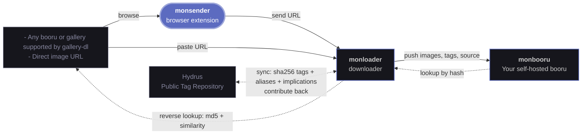

# monsender

A Firefox and Chrome extension for [monloader](https://github.com/monbooru/monloader). It sends the page you're on, a right-clicked image or video, or images you pick from the page to monloader's download queue, which pushes them into [monbooru](https://github.com/monbooru/monbooru).

[](https://addons.mozilla.org/en-US/firefox/addon/monsender/)
[](https://chromewebstore.google.com/detail/monsender/jhiaelblkhpfbmaijnlbmhpcjhghnack)

## Features

- Send the current page from the toolbar button or with Ctrl+Shift+L
- Right-click an image or video and choose **Send to monloader**
- Scan a page for images and pick which to send from a side panel
- Watch and manage the monloader queue

## Related applications

monsender is a companion browser extension for monloader. It hands the page you're viewing to monloader's download queue:



- **monsender**: this application; sends the URL of the page you're browsing to monloader.
- **[monloader](https://github.com/monbooru/monloader)**: downloader; fetches files and per-post metadata (via gallery-dl) and pushes them into a monbooru gallery over the REST API; also answers monbooru's reverse lookups (boorus, IQDB/SauceNAO, Hydrus PTR) and source refetches.
- **[monbooru](https://github.com/monbooru/monbooru)**: self-hosted booru; organizes, tags, and serves your collection.

## Install

Install it from [Mozilla Add-ons](https://addons.mozilla.org/en-US/firefox/addon/monsender/) or the [Chrome Web Store](https://chromewebstore.google.com/detail/monsender/jhiaelblkhpfbmaijnlbmhpcjhghnack).

Then open the extension's options, set your monloader URL, and click **connect to monloader**. Approve the request in monloader under **Settings → Pairing**, in the **monsender extension** block.

See the [monsender documentation](https://monbooru.github.io/mondocs/addons/monsender/index.html) for help.

## Permissions

`activeTab`, `scripting`, `storage` and `contextMenus` (plus `sidePanel` on Chrome). It reads a page only when you click, and sends only to the monloader URL you set. With previews on, the scan's thumbnails load from the sites hosting the images. See [PRIVACY.md](PRIVACY.md).

## Build

```
node build.js        # writes dist/chrome and dist/firefox
```

## License

[AGPL-3.0](LICENSE), with portions derived from MPL-2.0 code; see the license file.

## Acknowledgements

See [monbooru's acknowledgements](https://github.com/monbooru/monbooru#acknowledgements).
